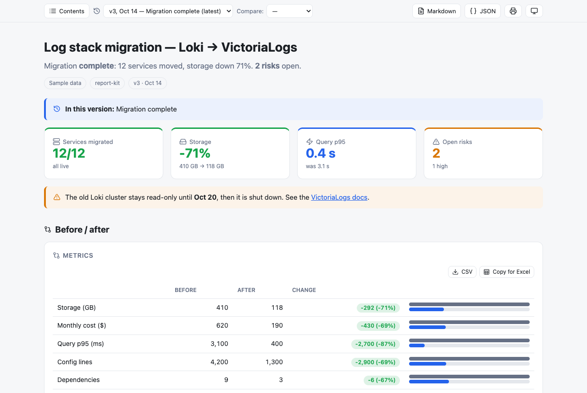
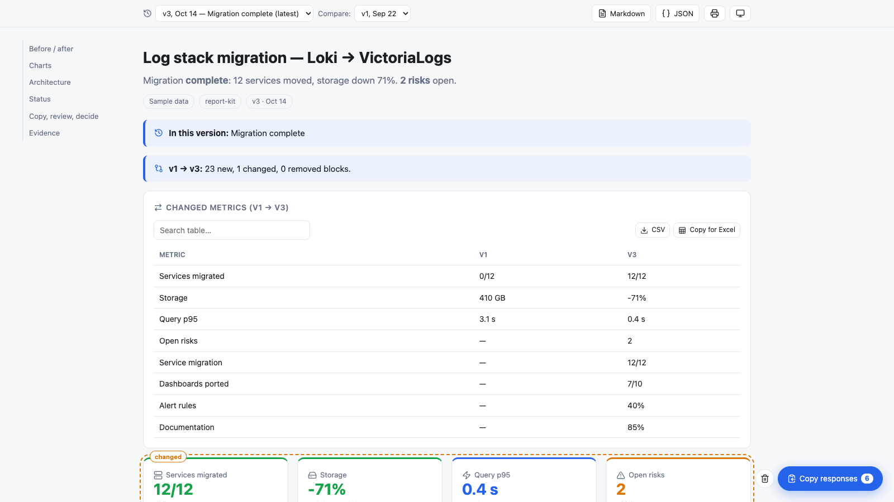
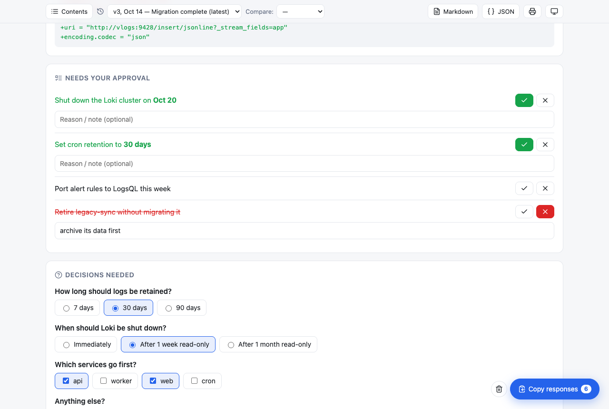
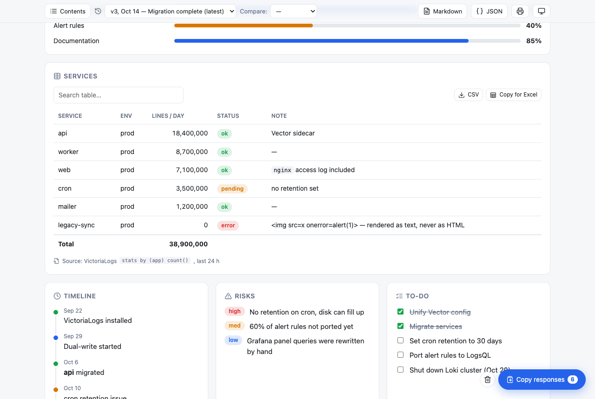
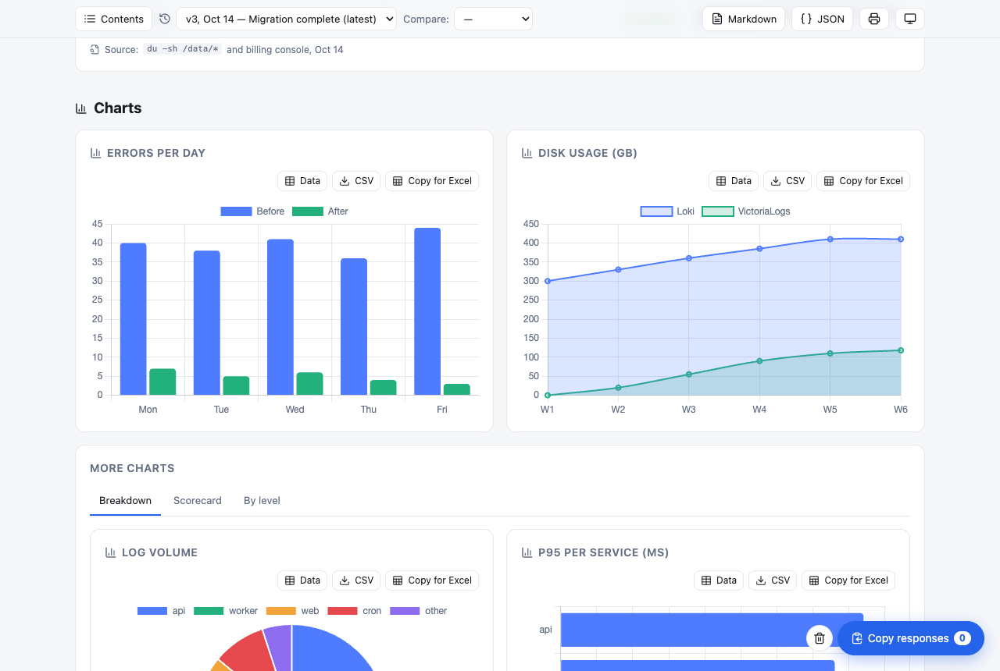
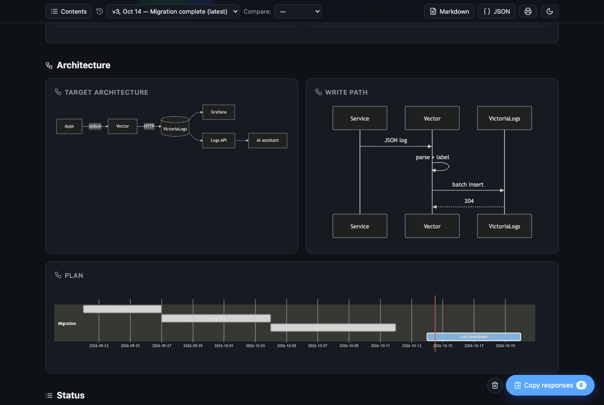
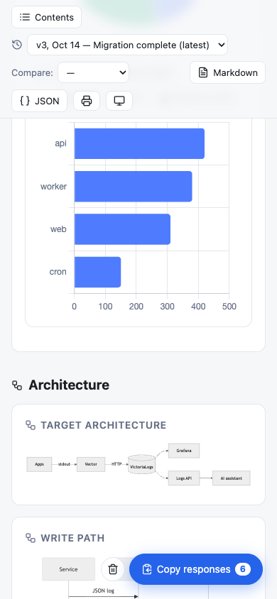

# report-kit

**Turn a small JSON spec into a single-file, interactive HTML report.**
Built for AI assistants: the model writes compact JSON, report-kit renders it into a consistent, safe, versioned report with charts, diagrams, tables, and a feedback loop back to the model.



- **Fewer tokens.** The model writes data, not layout. In the bundled example, v2 of the report is 638 characters of JSON because unchanged blocks are referenced, not repeated.
- **Same look every time.** One renderer, one design system, light and dark themes, works on mobile.
- **Safe by construction.** Every string is rendered with `textContent`. Raw HTML in the data is shown as text, never executed.
- **Versioned.** Append a new version to the file; readers can switch between versions and compare any two.
- **Two-way.** Readers answer questions, approve or reject items, tick to-dos and leave notes. One button copies everything as Markdown, ready to paste back into the AI chat.

**Live demo:** https://omert11.github.io/report-kit/examples/migration-report.html

---

## Quick start

```html
<!doctype html><meta charset="utf-8"><meta name="viewport" content="width=device-width,initial-scale=1">
<script src="https://cdn.jsdelivr.net/gh/omert11/report-kit@0.3.0/report-kit.min.js"></script>

<script type="application/json" class="rk-v">
{"title":"Weekly deploy summary","sum":"3 releases shipped, **0 rollbacks**.",
 "blocks":[
  {"kpi":[["Releases",3,"good"],["Rollbacks",0,"good"],["Lead time","1.2 d","info"]]},
  {"chart":"bar","title":"Deploys per day","x":["Mon","Tue","Wed","Thu","Fri"],"y":[1,0,1,0,1]},
  {"review":["Ship v2.4 on Monday","Freeze deploys during the migration window"],"title":"Approve"}
 ]}
</script>
```

Save the snippet as an `.html` file and open it in a browser. You don't need a build step or a server.

| CDN URL | Use |
| --- | --- |
| `https://cdn.jsdelivr.net/gh/omert11/report-kit@0.3.0/report-kit.min.js` | Pinned version (recommended) |
| `https://cdn.jsdelivr.net/gh/omert11/report-kit@0.3/report-kit.min.js` | Latest 0.3.x patch |
| `https://cdn.jsdelivr.net/gh/omert11/report-kit@0.3.0/report-kit.js` | Unminified |

Chart.js, Mermaid and Lucide icons are lazy-loaded from jsDelivr only when a report uses them.

## Using it with an AI assistant

Give the model [`SCHEMA.md`](SCHEMA.md) (under 1k tokens) and ask it to write reports as report-kit JSON. Then:

1. The model writes `report.html` with one `<script class="rk-v">` block.
2. You open the file. You can answer questions, approve or reject items, and leave notes on any card.
3. Click **Copy responses** and paste the result into the chat.
4. The model **appends** a new `<script class="rk-v">` block. Earlier versions stay untouched, and anything unchanged is referenced with `{"ref":"id"}`.

Validate the result without a browser:

```bash
npx --yes github:omert11/report-kit report.html
# ✓ report.html: 3 version(s), ok
# ✗ report.html: v2 blocks[3] chart: y.Errors length ≠ x length (5)
```

The same checks run in the browser. Problems are listed at the top of the report and counted in `<html data-rk-problems="N">`, which makes headless checks easy.

## Features

### Versions and comparison

Every `<script type="application/json" class="rk-v">` is one version, in file order. `title`, `sum`, `meta` and `lang` are inherited from the previous version. Pick a version from the toolbar, or link to one directly with `#v=2`. **Compare** shows a summary of new, changed and removed blocks, a table of changed KPI and progress values, and outlines every changed block.



### Interaction and the single copy button

`ask` (single choice, multiple choice or free text), `review` (approve or reject with a reason), clickable `todo`s, and a note box on every card. Responses are stored in `localStorage`. When there is at least one response, a single **Copy responses** button collects all of them:

```text
Report: Log stack migration — Loki → VictoriaLogs (v3, Oct 14) — my responses

## Decisions
- How long should logs be retained? → 30 days
- Which services go first? → api, web

## Approve / reject
- ✓ Approved: Shut down the Loki cluster on **Oct 20**
- ✗ Rejected: Retire legacy-sync without migrating it — archive its data first
```



### Tables and export

- Sortable columns.
- A search box appears automatically on tables with more than 5 rows.
- Status words (`ok`, `pending`, `error`, …) become badges.
- `"total": true` adds a totals row, recalculated from the filtered rows.
- Tables can be written as rows or as an array of objects.
- **CSV** downloads the current view: filtered and sorted, with a UTF-8 BOM and `;` separators, so Excel opens it in columns even in locales that use a decimal comma.
- **Copy for Excel** copies tab-separated values.
- Charts and diffs export the same way, and a chart's **Data** button shows the underlying numbers.



### Charts, diagrams, themes

- 8 chart types (Chart.js).
- Any Mermaid diagram: flowchart, sequence, gantt, and more.
- Tabs, columns and collapsible sections.
- Before/after image slider.
- Table of contents: a sticky sidebar on wide screens, a menu on narrow ones.
- Auto, light and dark themes.
- Print-friendly layout.
- **Markdown** and **JSON** export of the whole report.

| Charts | Dark mode | Mobile |
| --- | --- | --- |
|  |  |  |

## Block reference

A block is an object whose **type key** holds its data. Any block can also have:
- `title`: card heading
- `icon`: a [Lucide](https://lucide.dev/icons) icon name
- `id`: used by `ref` and by version comparison
- `src`: a "Source:" line shown under the card

| Type | Shape | Notes |
| --- | --- | --- |
| `h` | `"Heading"` | Section heading; listed in the table of contents |
| `p` | `"Text with **bold**, \`code\`, [link](https://…)"` | Inline Markdown subset |
| `callout` | `"Text"`, `tone` | `tone`: `good` \| `bad` \| `warn` \| `info` |
| `kpi` | `[[label, value, tone?, sub?, icon?], …]` | Stat cards |
| `progress` | `[[label, value, max=100, tone?], …]` | Progress bars |
| `diff` | `{before:{k:n}, after:{k:n}}`, `good`, `labels` | `good: "down"` colors decreases green; per-key object allowed |
| `chart` | `"bar"`, `x:[…]`, `y:[…]` or `y:{series:[…]}`, `height` | `bar` `hbar` `stacked` `line` `area` `pie` `doughnut` `radar` |
| `flow` | `"mermaid source"` | Rendered with `securityLevel: "strict"` |
| `table` | `[[header…],[row…]]` or `[{col: value}, …]`, `total`, `search` | Sort, search, totals, CSV / Excel |
| `timeline` | `[[when, text, tone?], …]` | |
| `code` | `"source"`, `lang` | `lang: "diff"` colors `+` / `-` lines; copy button |
| `copy` | `"text to paste"`, `text`, `lang` | Command or message with a copy button |
| `risk` | `[[text, high\|med\|low], …]` | |
| `todo` | `["text", ["text", true], …]` | Readers can tick items |
| `review` | `["text", ["id", "text"], …]` | Approve / reject with an optional reason |
| `ask` | `[{id, q, opt?, multi?, ph?}, …]` | Choice or free-text questions |
| `faq` | `[[question, answer], …]` | Collapsible; searchable when there are more than 4 |
| `img` | `"url"` or `{before, after}`, `labels`, `cap` | Before/after drag slider |
| `sources` | `[[text, cmd\|file\|link\|db, ref], …]` | Where the numbers came from |
| `tabs` | `{"Tab": [blocks], …}` | |
| `cols` | `[block, block, …]` | Responsive columns |
| `details` | `"Summary"`, `blocks: […]` | Collapsible section |
| `ref` | `"id"` | Reuse the newest earlier block with this id |

Top-level fields per version: `title`, `sum`, `meta` (chips), `date`, `note` (what changed), `lang` (`en` \| `tr`), `v` (label, defaults to its position), `blocks`.

## Security

- All text goes through `textContent`. The inline Markdown subset is parsed into DOM nodes, never `innerHTML`.
- Links must be `http(s)` and open with `rel="noopener noreferrer"`. Image URLs with `javascript:`, `vbscript:` or non-image `data:` schemes are dropped.
- The only `innerHTML` is Mermaid's SVG output, rendered with `securityLevel: "strict"`.
- The bundled example puts `` in a table cell; it is displayed as plain text.

## Languages

The UI ships in English and Turkish. Set `"lang":"tr"` on the first version, or use `<html lang="tr">`. Adding a language means adding one object to `I18N` in `report-kit.js`; pull requests are welcome.

## Browser support

Current Chrome, Edge, Firefox and Safari. The renderer uses CSS `:has()` and `color-mix()`. Reports need network access for the lazy-loaded Chart.js, Mermaid and Lucide.

## Development

```bash
git clone https://github.com/omert11/report-kit && cd report-kit
python3 -m http.server 8000   # open http://localhost:8000/examples/migration-report.html
node bin/rk-check.js examples/*.html
```

`report-kit.js` is a single dependency-free file. It also works as a CommonJS module in Node (`require("./report-kit.js").validate(versions)`), which is what the CLI uses.

## License

[MIT](LICENSE)
